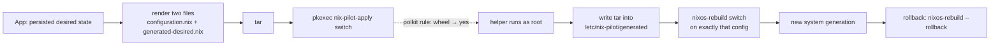

# nix-pilot NixOS module

One line in your NixOS config enables the system side of nix-pilot:

```nix
services.nix-pilot.enable = true;
```

What that does: it installs `nix-pilot-apply` (a small helper) and a polkit
action. The helper can only do three things, and only against the app-owned
directory `/etc/nix-pilot/generated/`:

- `build` and `switch` — read the generated configuration from standard input
  (a tar of `configuration.nix` + `generated-desired.nix`), write it into the
  app-owned directory, then run `nixos-rebuild build` / `switch` on exactly
  that file;
- `rollback` — go back to the previous system generation.

polkit is what shows the normal desktop password dialog. The wheel rule means
a wheel-group user gets authorized without further prompting, and the policy's
exec-path annotation limits `pkexec` to running exactly this helper — nothing
else can be elevated through it.

The app itself never switches a live system unless this module is installed
**and** the environment flag `NIX_PILOT_ALLOW_SWITCH` is set (see
`apply-activation.md`, decisions D24–D26).

## How applying a change works



The important property (D26, "publish-before-switch"): the config the switch
builds was just piped in on the same command — there is no stale file on disk
to accidentally switch.

## How it is verified (never on your real machine)

- `just app vm-probe` — proves the raw primitives in an isolated QEMU VM:
  adopt a candidate generation, activate it, roll back.
- `just app vm-apply` — proves the installed layer: the module installs the
  helper and polkit policy, `pkexec` authorizes a wheel user (including the
  exec-path annotation, the most common real-world `pkexec` failure), and the
  helper publishes the piped area before the switch.
- `just app module-check` — the module evaluates when enabled.

The only step no harness can cover is the desktop's actual password dialog;
that is standard polkit plumbing, and the rule/policy are the whole of it.