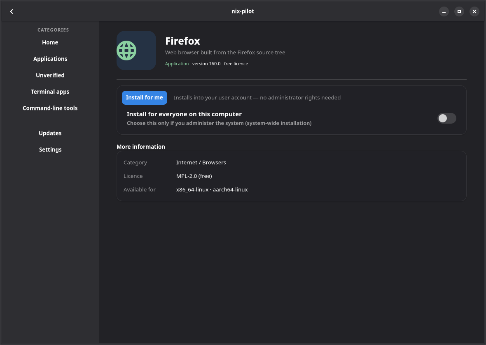
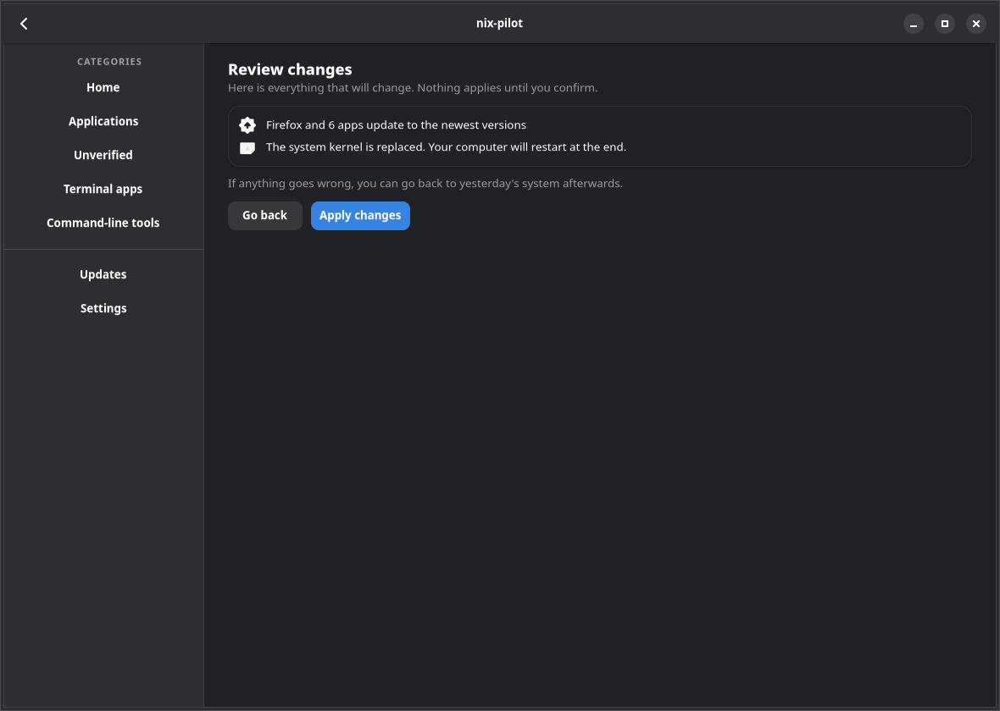
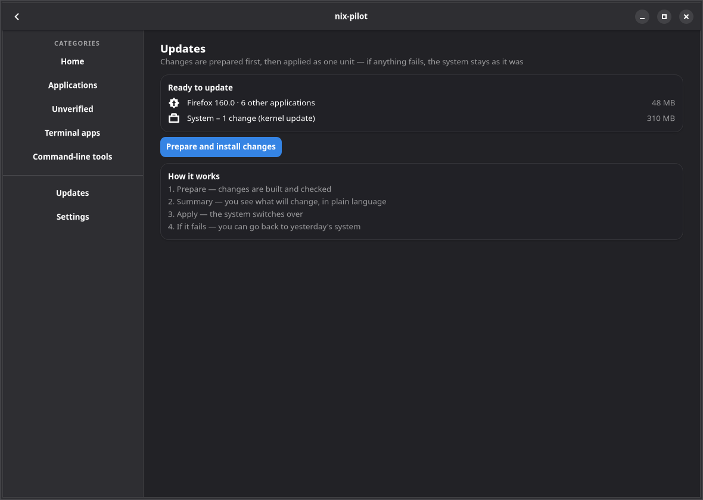
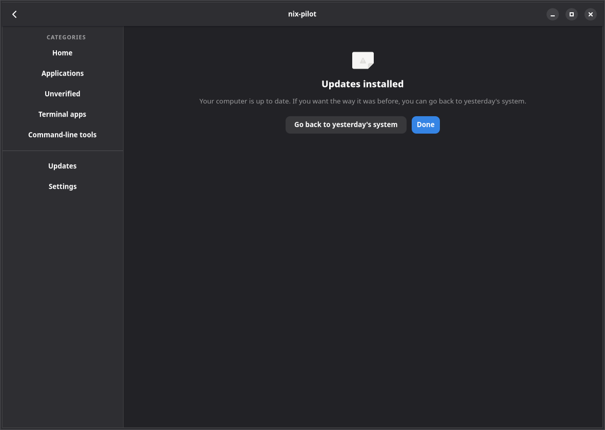
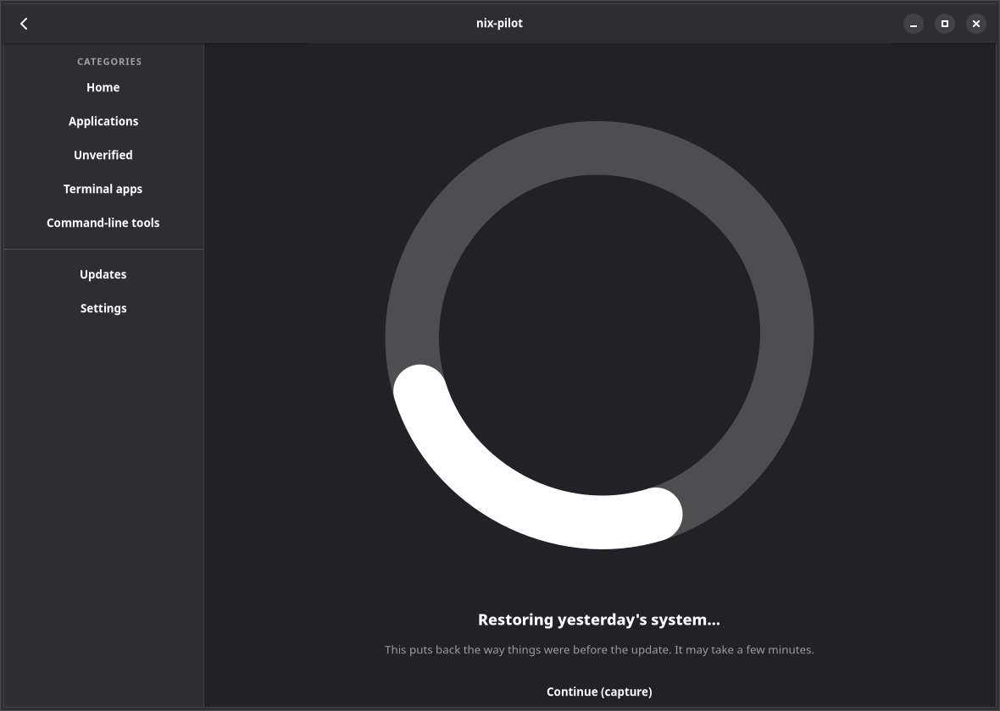
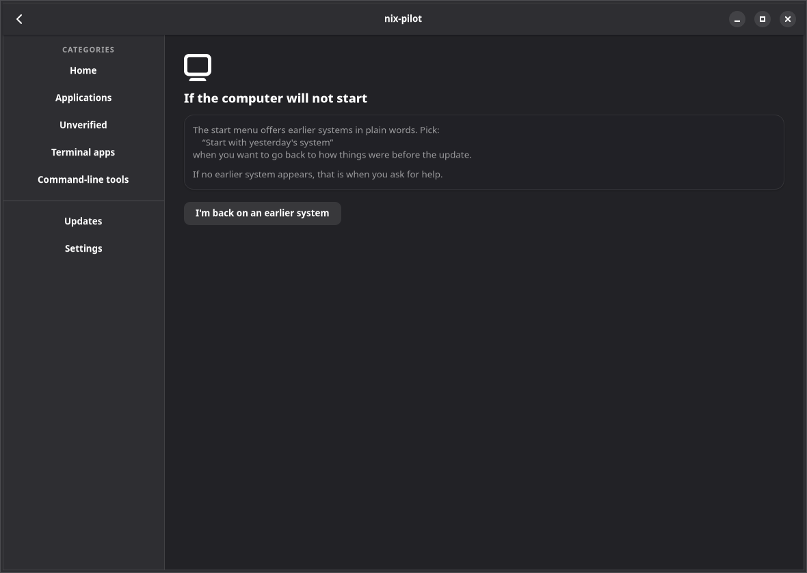

# Wireframe navigation map

The wireframes are a single clickable prototype (`just app proto`): one window,
sidebar + stack pages. This map is the at-a-glance route diagram; the PNGs are
the rendered states.

**Real-app parity (2026-11-19):** the app's live window now matches this layout
— a sidebar (Home / Settings / Updates) over a stack. Differences: the real
app's header carries the global search (catalogue-only v1, decided
2026-11-18), the Updates page's Prepare-and-build runs the real candidate build
(build-only, store never activated), updates/settings rollback state pages are
capture-only until 7wo.3, and the Settings page lists the REQ-5 areas with no
changeable workflow yet (9f3.8).

**Search is store-local:** the search field lives inside the Software Store page
(home + results), so it reads as "search the store". The header bar currently
has no search — the app-wide global search is a separate surface in the
architecture and is designed later.

Note: `just app` lists the app recipes; `just app proto` opens the prototype.

## Routes

```mermaid
flowchart LR
    START([Sidebar navigation]) --> HOME[Software Store · home]
    HOME -->|"click an app card"| DETAIL[Application detail]
    DETAIL -->|"Back"| HOME
    HOME -->|"type in the store search"| RESULTS[Search results · grouped]
    RESULTS -->|"clear search / Back"| HOME
    START -->|"Updates"| UPD[Updates · ready]
    UPD -->|"Prepare and install"| SUM[Update summary]
    SUM -->|"Apply changes"| APP[Applying]
    APP -->|"finish"| DONE[Done]
    DONE -->|"Go back to yesterday's system"| RB[Rollback]
    RB -->|"finish"| REST[System restored]
    UPD -.->|"build failure"| BF[Build failure · nothing changed]
    APP -.->|"apply failure"| AF[Apply failure · nothing half-applied]
    UPD -.->|"system will not boot"| BOOT[Boot recovery · "Start with yesterday's system"]
    BOOT -->|"I'm back on an earlier system"| REST
    START -->|"Settings"| SET[Settings · system-only]
    SET -->|"open a row"| SET2["Network · Display · Sound · Printers · Users · Power · Remote access (REQ-5, D14)"]
```

## States (rendered)

















## Decisions the prototype encodes

- Command-line tools appear only as a labelled group in search, never as app tiles (D16).
- Unconfirmed candidates sit in their own "Unverified" group, never as tiles (D18).
- Install is per-user by default, system-wide only when chosen (D9).
- Settings surface is system-only with pointers to the desktop's own tools (D14); it carries the plain-language recovery card that ships before any failure (failure-and-recovery.md).
- Updates is one transaction: prepare → review summary → apply (atomic) → done, with explicit build-failure ("nothing changed"), apply-failure ("nothing half-applied"), rollback ("go back to yesterday's system") and boot-recovery states (failure-and-recovery.md).

## Regenerating

```sh
just app build
just app wireframes            # all states, or named ones: `just app wireframes detail updates-summary`
```
