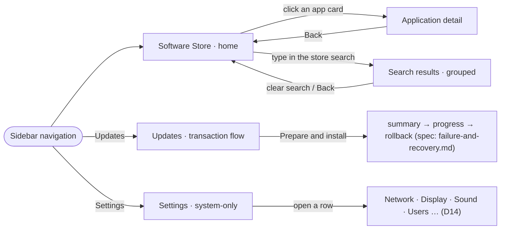
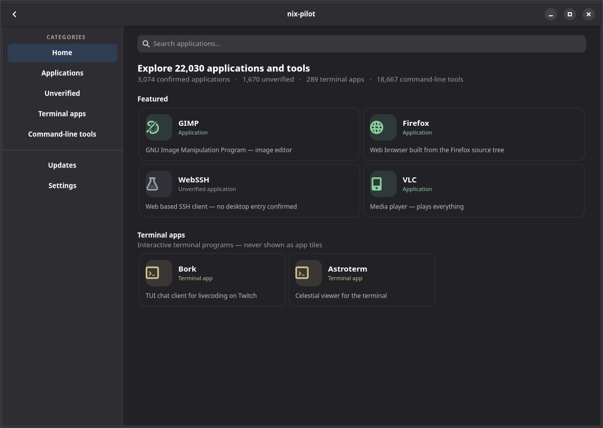
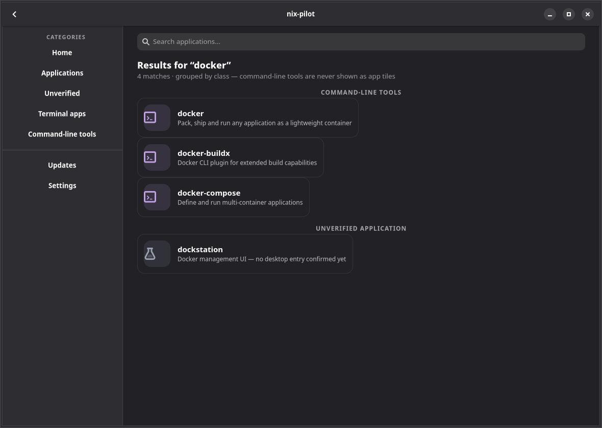
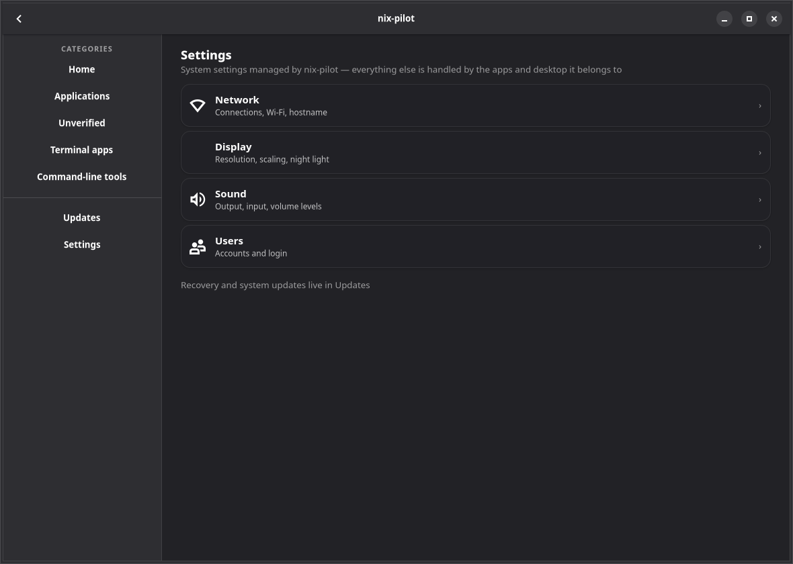
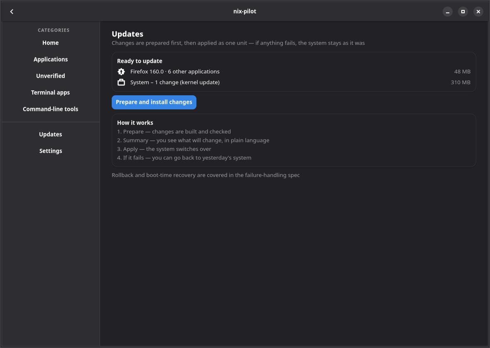

# Wireframe navigation map

The wireframes are a single clickable prototype (`just app proto`): one window,
sidebar + stack pages. This map is the at-a-glance route diagram; the PNGs are
the rendered states.

**Search is store-local:** the search field lives inside the Software Store page
(home + results), so it reads as "search the store". The header bar currently
has no search — the app-wide global search is a separate surface in the
architecture and is designed later.

Note: `just app` lists the app recipes; `just app proto` opens the prototype.

## Routes



## States (rendered)










## Decisions the prototype encodes

- Command-line tools appear only as a labelled group in search, never as app tiles (D16).
- Unconfirmed candidates sit in their own "Unverified" group, never as tiles (D18).
- Install is per-user by default, system-wide only when chosen (D9).
- Settings surface is system-only with pointers; recovery lives in Updates (D14).

## Regenerating

```sh
just app build
just app wireframes            # all states, or named ones: `just app wireframes detail`
```
