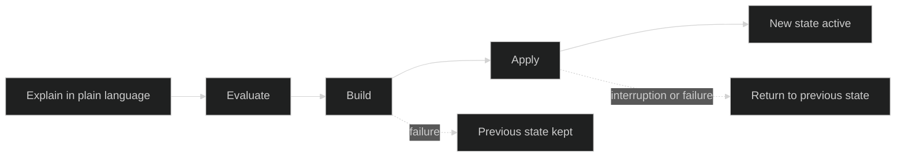

# Architecture

How the product is built: one desktop application (Settings, Software, Updates/Recovery, global search) over an application-owned desired-state model, a NixOS integration backend, and an independently generated catalogue service. Covers handover sections 7–8. Detail lives in the specifications: recovery behaviour and the transaction guarantee in [failure-and-recovery.md](specifications/failure-and-recovery.md), the settings surface in [settings-schema.md](specifications/settings-schema.md), the catalogue pipeline in [catalogue-pipeline.md](specifications/catalogue-pipeline.md).

## System overview

Two tracks: the catalogue track generates index artifacts from a pinned Nixpkgs revision, and the system track turns an application-owned desired state into NixOS generations. The application sits where both meet.

```mermaid
---
config:
  theme: dark
---
architecture-beta
    group catalogue(mdi:shape)[Catalogue service]
    group app(mdi:desktop-classic)[Desktop application]

    service sources(mdi:source-repository)[Nixpkgs and upstream metadata]
    service nixos(simple-icons:nixos)[NixOS system]

    service generator(mdi:cogs)[Catalogue generator] in catalogue
    service artifacts(mdi:archive)[Index artifacts] in catalogue

    service ui(mdi:monitor-dashboard)[User interface] in app
    service model(mdi:clipboard-check-outline)[Product model] in app
    service backend(mdi:server)[System backend] in app

    sources:B --> T:generator
    generator:B --> T:artifacts
    artifacts:R --> L:ui
    ui:R --> L:model
    model:B --> T:backend
    backend:R --> L:nixos
```

The connections, and what each does:

| From | To | Meaning |
|---|---|---|
| User | User interface | the user's only touchpoint; drives Settings, Software, Updates and search (documented here rather than drawn; see note) |
| Nixpkgs and upstream metadata | Catalogue generator | feeds the pinned revision plus AppStream and desktop-entry metadata for evaluation |
| Catalogue generator | Index artifacts | produces one versioned, universal index with per-entry architecture availability flags |
| Index artifacts | User interface | downloaded into the app's local cache for browse and search |
| User interface | Product model | edits the desired state; the model also feeds the UI back for display (two-way, one direction shown) |
| Product model | System backend | translated into generated NixOS configuration |
| System backend | NixOS system | builds and applies a new generation |

The User and the two metadata sources appear in the table rather than in the diagram, because this diagram type cannot draw two sources feeding the same unit without overlap (mermaid issue #6120; the fix needs mermaid 11.16+). The catalogue's handling of both is specified in the catalogue-pipeline spec. Icons are iconify names; they render only where the viewing tool registers the `mdi`/`simple-icons` packs, otherwise they fall back to a placeholder.

## User interface

- One integrated application with Settings, Software, Updates and Recovery areas and a global search spanning settings, applications and help (constraints [C3, C4](../../requirements/requirements.md#product-constraints)).
- Outcome-oriented language and visual controls; Nix syntax, concepts and configuration files stay out of the normal experience (constraint [C2](../../requirements/requirements.md#product-constraints)).
- Updates and Recovery present system changes as plain-language transactions with progress and rollback controls; the on-screen failure and recovery behaviour is specified in [failure-and-recovery.md](specifications/failure-and-recovery.md).
- Developer mode is optional, hidden by default, and never required for ordinary use (constraint [C8](../../requirements/requirements.md#product-constraints)).

## Product model

- The application owns a structured desired-state model: installed applications (with a selected version or variant where applicable), user-facing settings, enabled system capabilities and services, and generation and update/recovery status.
- The model is the source of truth; the NixOS configuration is generated output (constraint [C6](../../requirements/requirements.md#product-constraints); handover section 8).
- The structured desired-state schema and the settings schema are defined together in [settings-schema.md](specifications/settings-schema.md).

## Settings surface

- Settings workflows are product-authored, not generated: Nixpkgs cannot produce a consumer settings interface, so designing the workflows is product work, while the application catalogue is generated (decision [D4](../../research/04-recommendations.md#decision-log); requirement S3).
- The settings surface is a maintained product surface with a versioned schema and a documented migration path, so Nixpkgs option renames never silently break a user's settings (decision [D6](../../research/04-recommendations.md#decision-log); risk [R04](../risks.md#r04)).
- When a setting's backing option no longer applies, the UI tells the user "this setting no longer applies" instead of generating stale configuration.
- The surface is unbounded by nature; carrying and reviewing it is risk [R04](../risks.md#r04) and scope risk [R09](../risks.md#r09).

## NixOS integration backend

- The backend translates the product model into generated NixOS configuration and modules, evaluates it, builds a new system generation, presents a plain-language summary, applies it, and reports progress (handover section 7; Phase 1 steps 1–5).
- Nix is the implementation engine; nothing else from it reaches the normal user.
- Every system change is one transaction: explain, evaluate, build, apply, with rollback available after apply. The guarantee that a failed build or apply never leaves the system partially applied, and its Phase 1 tests, are specified in [failure-and-recovery.md](specifications/failure-and-recovery.md).

A change is a sequence of events, so this is an event flow, not a structure diagram:

- The mechanism that makes the switch between system states atomic is chosen together with the installation mechanism (below).

## Install and system-state model

- For the initial release the application owns the configuration it generates; the desired-state model is the source of truth and the NixOS configuration is generated output (handover section 8).
- Installing or removing an application updates the desired package set and deploys a new system generation.
- The package deployment is declarative, with a single owner: the generated NixOS config. Each install carries a scope chosen at install time — per-user by default (`users.users.<name>.packages`), system-wide only when explicitly chosen (`environment.systemPackages`). No imperative per-user profiles. One system generation per change, uniform rollback through the existing generation and boot-menu recovery (decision [D9](../../research/04-recommendations.md#decision-log)).

## Catalogue service

- The catalogue is an independent generator product, not a side effect of the application (handover section 7).
- It consumes a pinned Nixpkgs revision and upstream metadata, produces one versioned, universal index with per-entry architecture availability flags, and publishes it on a periodic regeneration cadence; pipeline details are in [catalogue-pipeline.md](specifications/catalogue-pipeline.md) and revision drift is risk [R07](../risks.md#r07) and risk [R12](../risks.md#r12).
- The desktop application consumes the artifacts and keeps a local searchable cache; when a listed package does not match the running system, "unavailable on your system" is a first-class UI state, not an error (risk [R07](../risks.md#r07)).
- Catalogue content is generated only: no hand-maintained per-package entries, and curated behaviour (featuring, categories, ranking) stays explainable and never required for installation (decision [D4](../../research/04-recommendations.md#decision-log)).

## Cross-cutting

- Architecture choices must remain maintainable by a one-to-two-person volunteer team for five years, applied to schema versioning, catalogue format stability and framework choice (recommendation 8; decision [D7](../../research/04-recommendations.md#decision-log)).
- Developer diagnostics — raw Nix configuration, option provenance, module diagnostics, evaluation details — stay separate from the normal experience (handover section 7; constraint [C8](../../requirements/requirements.md#product-constraints)).
