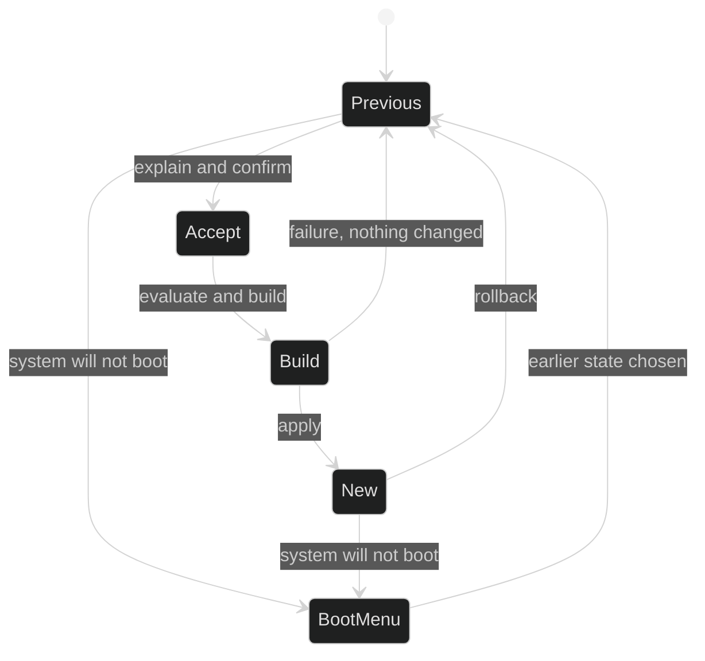

# Failure and Recovery

A non-technical user must be able to recover to a working system when a change fails or the system will not boot, without using Nix and without opening a terminal. Implements [REQ-4](../../requirements/requirements.md#derived-user-requirements) and the recovery journeys in [user-needs.md](../../requirements/user-needs.md#recovery-as-a-need); closes risks [R03](../risks.md#r03) and [R08](../risks.md#r08). Written before Phase 2 UI work, because the recovery story has to exist before the "hide Nix" surface is built (decision [D5](../../research/04-recommendations.md#decision-log)).

## System changes as transactions

- Every system change (install, uninstall, setting change, update) is one transaction: explain, evaluate, build, apply. Rollback stays available after apply. The system is on the previous state until the switch, and on the new state after it.
- Before any change, the user sees one plain-language summary of what will change (REQ-3).
- The previous working state is always recoverable (REQ-8).

The states a change moves through, and where each failure returns to:

## Build failure

A failed build changes nothing on the system. The UI shows:

- The failure in plain language, tied to the operation the user started.
- The raw error one click away, marked as technical detail (constraints [C2](../../requirements/requirements.md#product-constraints) and [C8](../../requirements/requirements.md#product-constraints)).
- The available actions: retry the change, or stay on the current system. No recovery action is required, and the UI says so.

## Apply failure

When an apply is interrupted or fails:

- The system returns to its previous working state; the UI states plainly that nothing was left half-applied.
- A failed apply never leaves the system partially changed (R08). The switch between states is atomic: at any instant the system is wholly on the previous state or wholly on the new state. The mechanism is chosen in the architecture document; this property is tested below.

## System will not boot

Recovery runs before any application starts, so it cannot be in-app:

- The boot menu offers earlier system states in plain words ("Start with yesterday's system"), never in Nix vocabulary.
- The recovery how-to ships before the failure: a recovery card in Settings explains what to do when the computer will not start, which boot option to pick, and when to ask for help.
- Once the earlier state boots, the app says plainly that the system was restored, and offers to retry the change or ask for help.

## Per-user installs on a home-manager system

Per-user installs on a system whose config enables the home-manager module
(decision D22) roll back as **home-manager generations**, not system
generations: lighter, activated on the user session, and with no boot-menu
stakes — a bad per-user change at worst breaks the user environment, never the
system boot. Everything above (one transaction, build failure changes nothing,
apply failure returns to the previous state) still applies within that lighter
scope. System-wide changes always ride the system generation with boot-menu
recovery.

## Rolling back

- Rollback is "go back to yesterday's system", not a technical operation. No Nix vocabulary.
- When a change applied but the user wants the previous state, or an applied generation partially changed the system, the app performs the return itself and explains what was undone: which application was removed, which setting reverted.

## Tested guarantee

A failed build or apply never leaves the system partially applied, and a user whose change fails can recover to a working system without a terminal and without reading Nix output.

Tested in Phase 1:

- Inject failure at every stage of the transaction: build fails, apply interrupted, process killed mid-switch, restart mid-transaction. The system after each failure must be exactly the previous state.
- Fail a change, then recover through the UI alone, using only plainly-worded prompts (the failure-handling acceptance criterion tightened in [the recommendations](../../research/04-recommendations.md)).
- Boot the previous state from the boot menu; the app reports the restoration in plain language.
- A system not wholly on one state is a release blocker.
